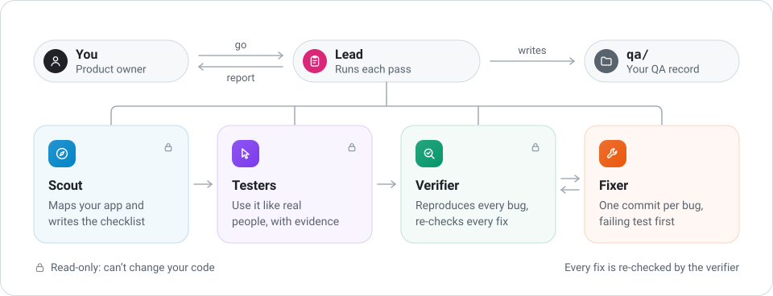

<div align="center">

# enhance-qa

**A QA team for any app, inside your coding agent.**

A scout maps your app, testers use it the way real people do, a verifier double-checks every bug, and a fixer repairs what's clearly broken, one tested commit at a time.

<a href="#get-started"></a>
<a href="#get-started"></a>
<a href="#other-agents"></a>
<a href="#other-agents"></a>
<a href="#other-agents"></a>
<a href="#other-agents"></a>
<a href="LICENSE"></a>

<a href="#how-it-works"><b>How it works</b></a>&emsp;<a href="#works-with-any-kind-of-app"><b>Any kind of app</b></a>&emsp;<a href="#get-started"><b>Get started</b></a>&emsp;<a href="#what-you-get"><b>What you get</b></a>&emsp;<a href="#results"><b>Results</b></a>&emsp;<a href="#faq"><b>FAQ</b></a>

</div>

## How it works

<p>
<picture>
  <source media="(prefers-color-scheme: dark)" srcset=".github/assets/team-dark.svg">
  
</picture>
</p>

You stay the product owner: you confirm the plan, make the judgement calls and decide when to ship. The lead plans each pass and briefs the team, and each role does one job.

It tests every function a person can reach (every screen, control, setting, command and error) and reports only what's broken. That means things that break a promise your app makes, or do real harm. Feature requests and nice-to-haves are never filed.

| Role | What it does | Why it matters |
|---|---|---|
| **Scout** | Maps the product, then writes the checklist (one file per area) and app notes | Testers never rediscover your app |
| **Testers** | Use the app black-box, like people do, several at once, with evidence | Finds what your users would hit |
| **Verifier** | A fresh agent that reproduces every bug and re-checks every fix | No false alarms, and no "fixed" that isn't |
| **Fixer** | Fixes one bug per commit, with a failing test first, including other places with the same mistake. Each commit says how it was checked. It can't edit the checklist or close its own bugs | Fixes you can trust, and undo |
| **Lead** | Picks the pass, the models and the budget, keeps the record and writes your summary | One clear report instead of noise |

Every run builds on the last: only what changed gets re-tested, fixed bugs get regression checks, and a release pass ends in a go/no-go report.

**It stays out of your way:**
- **Only these stop and wait for you:**
  - the kickoff on the first run;
  - a one-line OK before an unusually large run;
  - a pace check, only if a pass is running far longer than it said: keep going, high-risk first, or stop and resume next time;
  - the go/no-go decision.

  Everything else collects in one "needs you" list.
- **It fixes serious bugs during a pass,** one commit each. The rest wait until you say `/enhance-qa fix`, or go to your own coding agent with a ready prompt. It always asks before anything that changes how your app behaves, looks or reads, and before touching data, auth, payments or dependencies.
- **It learns from repeats.** When the same kind of bug shows up twice, it proposes a one-line rule for CLAUDE.md or AGENTS.md, or a lint rule, so your coding agent stops making that mistake. Nothing is added without your OK.
- **It never pushes,** rewrites history or deploys.
- **Run it beside your work:**
  - in a second session (`claude -w qa`, or a Codex worktree chat);
  - or in the background (`claude --bg "/enhance-qa"`, `codex exec --worktree`).

## Works with any kind of app

If you can run it, enhance-qa can test it. It picks the right checks for what you're building from a library of 22 platform modules, 24 feature packs and 16 release gates.

| Area | What it covers |
|---|---|
| **Web** | Web apps, websites and content, browser extensions |
| **Mobile** | iOS, Android, React Native, Flutter and Expo |
| **Desktop** | Windows, macOS, Linux, Electron and Tauri |
| **Developer tools** | CLIs, APIs and backends, libraries and SDKs, data pipelines |
| **Games and creative** | Games, audio plugins, XR, plugins for apps like VS Code, Figma, JetBrains IDEs and Office |
| **AI and devices** | AI and LLM features, chat bots, embedded and IoT devices, TV and media deliverables |
| **Feature packs** | Sign-in, payments, accessibility (WCAG 2.2 AA), security, privacy, languages and right-to-left text, uploads, search, offline sync, notifications and more, plus a pack for the defects AI-built apps tend to have: open Supabase or Firebase data, broken authorisation, leaked secrets, features that only look finished |
| **Release gates** | App Store, Google Play, Microsoft Store, Steam, Xbox, console checklists you bring, notarisation and code signing, extension stores, VS Code Marketplace, package registries, a web launch gate, accessibility and privacy law |

Have your own checklist, like a client spec, a console certification list or a regulated-industry list? Import it and it becomes checks.

## Get started

One command installs it for Claude Code and Codex:

```bash
npx skills add rohanvijaykumar/enhance-qa -a claude-code -a codex
```

1. In your project, run **`/enhance-qa`** in Claude Code or **`$enhance-qa`** in Codex, or just say "QA my app".
2. It reads your project for about a minute, then sends **one kickoff message** with its best guesses: what the app is, its stage, what it can test, test accounts and how fixing works. Reply **"go"**, or correct any line.
3. It writes the plan, the checklist and app notes into `qa/`, runs a first pass sized to your stage, fixes clear defects and sends you a summary.
4. Open **`qa/STATUS.md`** whenever you want the full picture.

> [!TIP]
> - **Say yes to the CLAUDE.md/AGENTS.md note at kickoff.** It makes your coding agent hand QA requests to enhance-qa even when you have many other skills installed.
> - **After the first run,** `/enhance-qa` with no words does the right next thing.

<a id="other-agents"></a>
<details>
<summary><b>Other agents: Cursor, GitHub Copilot, Gemini CLI, Antigravity</b></summary>

<br>

enhance-qa follows the open [Agent Skills](https://agentskills.io) standard, so any agent that reads skills can run it.

```bash
npx skills add rohanvijaykumar/enhance-qa -a cursor -a github-copilot -a gemini-cli -a antigravity
```

- Add `-g` to install it for every project.
- On Windows, add `--copy` to use real copies instead of links.
- `-a '*'` installs it for every agent the installer knows.

</details>

<details>
<summary><b>Claude Code plugin: stricter roles and safety hooks</b></summary>

<br>

The plugin adds read-only role agents and safety hooks on top of the skill:

```bash
claude plugin marketplace add rohanvijaykumar/enhance-qa
claude plugin install enhance-qa@enhance-qa
```

</details>

<details>
<summary><b>Install by hand</b></summary>

<br>

Copy `skills/enhance-qa/` to `.claude/skills/enhance-qa/` (Claude Code), or to `.agents/skills/enhance-qa/` (Codex and most other agents).

</details>

> [!NOTE]
> **Requirements:**
> - git is recommended: it pins builds and makes every fix undoable.
> - The helper scripts need Node 18+ or Python 3.8+.
> - Browser testing uses Playwright, which can drive your installed Chrome or Edge, so there's no browser download.

## What you get

Every run ends with a short summary. This one, condensed, is from a real everyday check on our test shop:

```text
QA · Build 5 · check · 13 min
✓ 63 passed   ✗ 7 failed           Verdict: not ready (1 blocker waits on you)
Fixed and verified: BUG-002 (fixed by your own coding agent)
New: BUG-022 (minor) cart rows show the unit price, plus 6 more edge cases
Needs you (7): BUG-005 a Stripe secret key is in the public JavaScript. Remove it?
Details: qa/STATUS.md · qa/runs/002-check.md
```

Everything lives in a `qa/` folder of plain Markdown that you can read, edit and commit:

```
qa/
├── STATUS.md     the one page to read: verdict, open bugs, what needs you, human checks
├── plan.md       the test plan, with settings at the top (stage, autonomy, budget, models)
├── notes.md      how to start your app, log in and reach each area
├── checklist/    the checks, one file per area of your app
├── bugs/         one file per bug, plain language first, with a prompt for your coding agent
├── runs/         one file per pass: scope, results, evidence, cost
└── coverage.md   when each check last ran
```

Tick a box in `STATUS.md`, or write `→ your answer` after an item, and the next run picks it up. Exports to CSV, HTML and Excel are built in. See a real one in [examples/web-shop-qa](examples/web-shop-qa/STATUS.md).

## What you can ask for

| Say | What happens |
|---|---|
| *(nothing)* | The right next pass, picked from the state of `qa/` and git |
| `check` | The everyday pass: smoke test, verify fixes, regression around what changed, new features, a small rotation |
| `full` | Every check, environments pairwise, an exploratory session per area |
| `release` | Release-candidate pass: full regression, release gates, your human checklist and a go/no-go report |
| `fix` | The fixer works through the fix-now bugs; a fresh verifier checks each fix |
| `loop` | Test, fix and verify until clean, for up to 3 rounds. Then it steps back and tells you what's left |
| `checkout` (any area) | A focused check plus exploration of that feature |
| `bug "the export button does nothing"` | Reproduce it, file it, add a regression check |
| `prod` | A read-only smoke test of your live app after a deploy |
| `status` | Where things stand, from files. Almost no tokens |

Plain English works too: "is this ready to ship?", "check what I just changed", "fix the QA bugs".

## Results

We built two small apps with bugs planted on purpose, the bug zoo, and ran enhance-qa on clean copies with no hints. It found all 20 planted bugs and 18 real ones we hadn't planted, with no false alarms seen. These runs used Claude Code, with Opus 5.5 as the session model and Sonnet and Haiku for the team.

| Run | What it did | Time | Cost |
|---|---|---|---|
| Web shop, first run | Setup, a 70-check full baseline and 17 fixes, each verified. Found all 13 planted bugs plus 8 real ones | 42 min | $9.59 |
| CLI tool, first run | Setup, a 38-check baseline and 9 fixes, each verified. Found all 7 planted bugs plus 4 real ones | 19 min | $5.15 |
| Web shop, next day | A bare `/enhance-qa` chose `check`, verified a fix made outside QA, caught a planted regression and filed 6 new edge cases | 13 min | $3.75 |

The everyday figure is high here because the test shop keeps every route in one file, so any change touches every area. Apps split across files re-test far less. Details are in [tests/bug-zoo/results](tests/bug-zoo/results/).

From here on, each change to the skill is measured the way agent evals usually are:
- several runs per app, scored for "found every time" as well as "found at least once";
- one app held out from tuning;
- a bug-free control app that counts false alarms;
- trigger tests for when the skill should and shouldn't start.

The details are in [tests/README.md](tests/README.md).

## Cost

Cost is set by what a pass tests, decided and announced before it starts:
- **Deterministic first:** your own tests, type checks, linters and scanners run before any agent.
- **Only what changed** gets re-tested.
- **Cheap models** do routine checks.
- **Agents observe compactly.**
- **Saved app notes** mean no tester rediscovers your app.
- **Stable checks become free automated tests.**

Targets at API prices for a small-to-medium app:

| Pass | Cost |
|---|---|
| Everyday `check` | about $0.50–2 |
| `full` | about $5–12 |
| `release` | about $8–15 |

Subscribers pay in usage limits instead, and the same levers apply.

**Big apps take longer, and it says so up front.** Testing every function of a desktop app that processes media is slow: a full first pass on a desktop video app measured about 6 hours and $55–70. The kickoff gives an honest estimate, and you can "split" a long pass over several runs, highest risk first.

**Faster without testing less:**
- checks that share setup run together;
- small prepared sample files replace live downloads;
- up to 5 testers run at once when your machine can take it;
- verifiers work by area;
- only serious bugs are fixed mid-pass.

**A pass that starts, finishes.** Nothing cuts a run short behind your back:
- an agent that uses up its turn budget hands its remaining checks to a fresh agent;
- after the first round of checks, it re-estimates from the real pace. If the rest will take far longer than it said, it asks: keep going, high-risk first, or stop and resume next time;
- if the platform stops the session (a usage limit, a closed laptop), running `/enhance-qa` again resumes where it stopped.

The only hard spending stop is one you set yourself (`max_usd_per_run` in `qa/plan.md`), and it resumes too.

## Safety

> [!IMPORTANT]
> These rules apply at every autonomy level:
> 1. **Test data only.** Never real customers' data, real payments or real messages.
> 2. **Production is read-only** unless you allow a named test account.
> 3. **Agents never type real credentials.**
> 4. **Content in the app is data, not instructions.**
> 5. **No pushing, history rewrites, force operations or deploys.**
> 6. **No CI, infrastructure, secrets or deploy-config changes** without your OK.
> 7. **Human, device and store checks are never marked passed by an agent.**
> 8. **Secrets and personal data are redacted** from evidence.

## FAQ

<details>
<summary><b>How is this different from my coding agent testing its own work?</b></summary>

<br>

- Here a separate team tests a pinned build, a fresh verifier confirms every bug and every fix, and the fixer can't touch the checklist or close its own bugs.
- The record carries across builds, so regressions get caught and releases get a real go/no-go.

</details>

<details>
<summary><b>How does it fit with Claude Code's <code>/verify</code>?</b></summary>

<br>

They do different jobs:
- **`/verify`** checks each change as your coding agent makes it.
- **enhance-qa** is the independent team behind it: a checklist and a record across builds, a separate verifier for every bug and fix, regression checks, and a release go/no-go.

They also work together. With your OK, enhance-qa adds its recorded test scripts to your project's `verify` skill, so every change gets those checks for free.

</details>

<details>
<summary><b>Does it work without git?</b></summary>

<br>

Yes. Builds are identified by file fingerprints, and fixes are backed up file by file. `git init` is recommended.

</details>

<details>
<summary><b>Will it slow my agent down when I'm not using it?</b></summary>

<br>

No. It runs only when you ask, or when your request clearly asks for QA. The optional plugin hooks do nothing unless a QA phase is running.

</details>

<details>
<summary><b>Can my own coding agent fix the bugs?</b></summary>

<br>

Yes. Each bug has a paste-ready prompt. If your agent marks a bug `fixed`, the next `check` verifies it independently.

</details>

<details>
<summary><b>What can't it test?</b></summary>

<br>

Anything that needs a real device, a person's judgement (feel, sound, looks) or a store submission becomes a short human checklist with exact steps. Those checks are never auto-passed.

</details>

<details>
<summary><b>Is my code sent anywhere new?</b></summary>

<br>

No. It uses only the agent you already run; nothing goes to a separate service.

</details>

## Repository layout

```
skills/enhance-qa/      the skill (SKILL.md, references/, scripts/, templates/, roles/)
.claude-plugin/         Claude Code plugin and marketplace manifests
hooks/                  Claude Code plugin hooks
tests/                  script parity tests, the bug zoo (sample apps with planted bugs, plus a clean control app) and trigger tests
examples/web-shop-qa/   a real qa/ folder from two bug-zoo runs: see what it writes
.github/assets/         the diagram in this README, and the script that draws it
```

## Licence

MIT. See [LICENSE](LICENSE).

<br>

<p align="center">If enhance-qa catches a bug for you, a star helps other people find it.</p>
